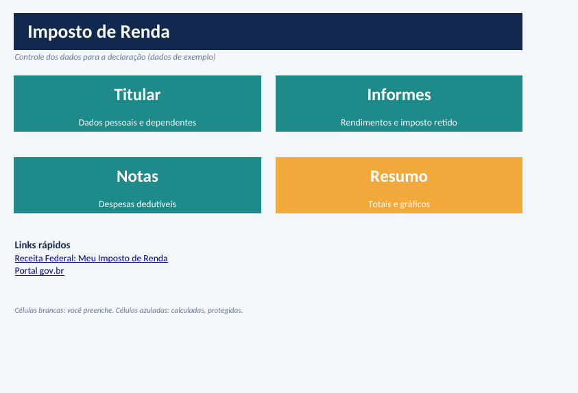
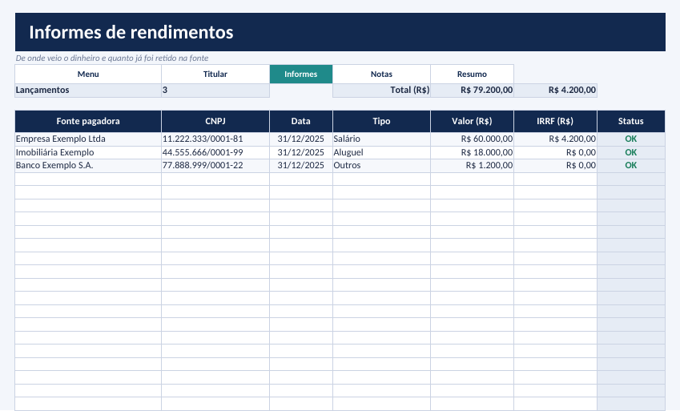
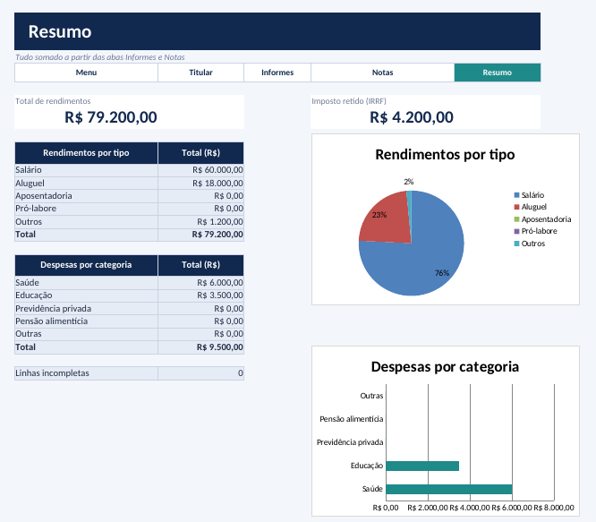

# Controle de dados para o Imposto de Renda (Excel)

Montei uma planilha para juntar num lugar só o que preciso na hora de declarar o Imposto de Renda: meus dados, os informes de rendimentos e as despesas que podem ser deduzidas. Tem menu de navegação, listas e validações para não digitar bobagem, e um resumo com totais e gráficos. Todos os dados do arquivo (nomes, CPF, CNPJ, valores) são inventados, de exemplo.

## Como ficou

| Menu | Informes | Resumo |
|---|---|---|
|  |  |  |

Também tem print do [Titular](imagens/02-titular.png) e das [Notas](imagens/04-notas.png).

## O que tem em cada aba

- **Menu**: quatro botões que levam às telas e dois links rápidos (Receita Federal e gov.br). Todas as abas têm uma barra para voltar ao menu ou pular para outra tela.
- **Titular**: nome, CPF, nascimento, e-mail, ano-calendário e até 3 dependentes, com a contagem feita sozinha.
- **Informes**: fonte pagadora, CNPJ, data, tipo, valor e imposto retido. Cabem 100 linhas. A coluna Status avisa quando uma linha ficou incompleta.
- **Notas**: prestador, documento, data, categoria e valor, também com 100 linhas e Status.
- **Resumo**: total de rendimentos e de imposto retido, rendimentos por tipo, despesas por categoria, um gráfico de pizza, um de barras e a contagem de linhas incompletas.

Células brancas são para preencher. As azuladas são calculadas e ficam protegidas.

## O que usei do Excel

- **Validação de dados**: listas suspensas (tipo de rendimento, categoria, parentesco), valor que não pode ser negativo, CPF só com 11 números e data de nascimento que tem que ser anterior a hoje.
- **Intervalos nomeados**: `lista_tipos`, `lista_categorias`, `lista_parentesco`, `tipo_informes`, `valor_informes`, `irrf_informes`, `cat_notas` e `valor_notas`. O resumo soma com `SOMASE` usando esses nomes em vez de endereços de célula.
- **Formatos personalizados**: o CPF e o CNPJ ficam guardados só com números e aparecem com pontos e traço (`000"."000"."000"-"00`).
- **Formatação condicional**: Status em verde ou vermelho e linhas alternadas.
- **Toques finais**: sem linhas de grade, sem títulos de linha e coluna, sem as guias de baixo (a navegação é pelos botões), aba de apoio escondida e abas protegidas só nas células calculadas. A proteção não tem senha.

## Conferência

Somei os dados de exemplo na mão: rendimentos de R$ 79.200,00 (60.000 + 18.000 + 1.200), imposto retido de R$ 4.200,00 e despesas de R$ 9.500,00 (saúde 6.000 e educação 3.500). O resumo mostra os mesmos valores e a planilha recalculada não deu erro de fórmula.

## O que ficou de fora ou sem testar

- Ela só organiza dados. Não calcula imposto devido nem aplica limite de dedução, então não coloquei nenhuma tabela da Receita. Para regra fiscal, vale olhar o site da Receita ou falar com um contador.
- Não fiz função personalizada nem macro (VBA).
- Conferi tudo no LibreOffice, não no Excel. Os links e as mensagens de erro das validações com digitação não testei.
