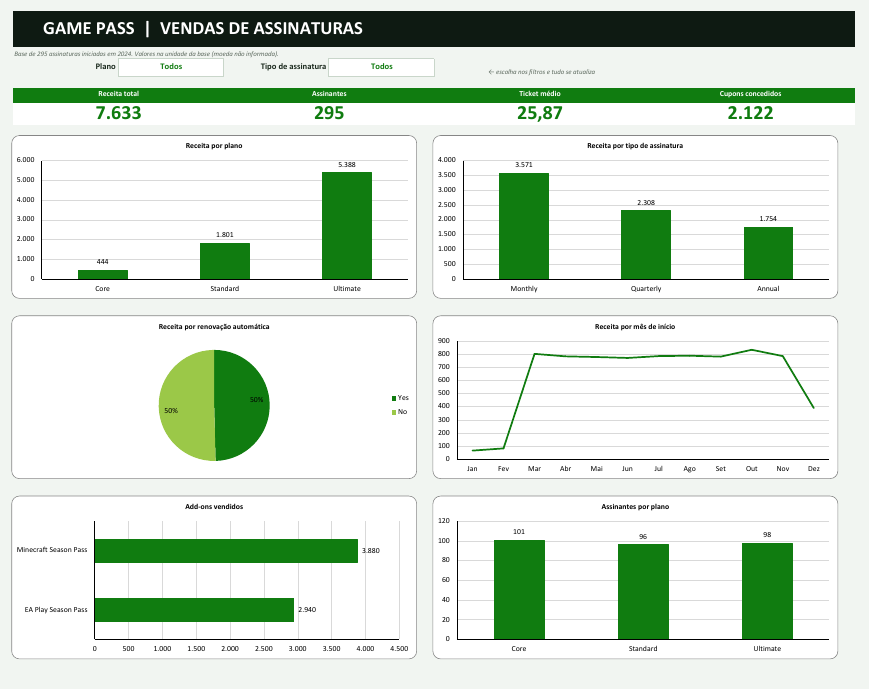
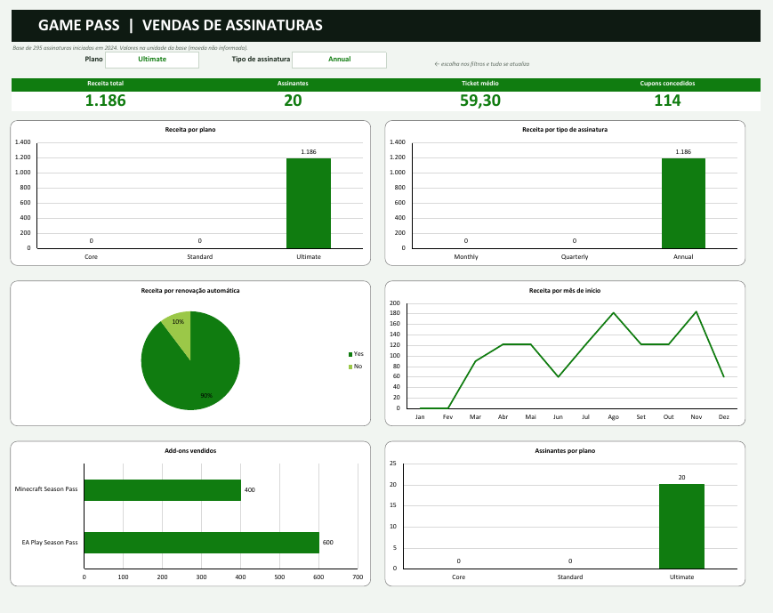

# Dashboard de vendas de assinaturas do Game Pass (Excel)

Dashboard em Excel feito a partir de uma base de 295 assinaturas do Game Pass iniciadas em 2024. A ideia foi transformar a tabela bruta em números e gráficos que respondam rápido a perguntas como "quanto cada plano rende?" e "o que pesa mais na receita, plano ou tipo de assinatura?".

## Como ficou

Com os filtros (aqui Plano = Ultimate e Tipo = Annual), os indicadores e os gráficos se atualizam:

## Os dados

A base tem uma linha por assinante: ID, nome, plano (Core, Standard ou Ultimate), data de início, renovação automática, preço da assinatura, tipo (Monthly, Quarterly ou Annual), se contratou EA Play e/ou Minecraft Season Pass (com os preços), valor do cupom e valor total. Em todas as 295 linhas conferi que `Total Value = assinatura + EA Play + Minecraft - cupom`. Não há células vazias. Nas linhas sem EA Play a coluna de preço vem com `-` (texto), e as fórmulas ignoram esse texto.

A moeda não vem informada na base, então os valores aparecem sem símbolo.

Peguei a base da aba de dados do arquivo do dashboard finalizado da DIO, porque o link da `base.xlsx` bloqueou o download aqui. O dashboard, as fórmulas e os gráficos são meus.

## O que tem no arquivo

- **Dashboard**: dois filtros (plano e tipo de assinatura), quatro indicadores (receita total, assinantes, ticket médio e cupons) e seis gráficos: receita por plano, por tipo de assinatura, por renovação automática, por mês de início, add-ons vendidos e assinantes por plano.
- **Cálculos**: as fórmulas que alimentam o dashboard (`SOMASE`, `CONT.SES` e `SOMASES` sobre intervalos nomeados como `b_total`, `b_plano` e `b_tipo`) e um bloco de perguntas de negócio.
- **Base**: os dados como tabela do Excel.

Os filtros funcionam assim: a escolha vira um critério (`Todos` vira `*`) e entra em todas as fórmulas da aba Cálculos.

## Perguntas de negócio e respostas (base inteira)

| Pergunta | Resposta |
|---|---|
| Faturamento total dos planos anuais | 1.754 |
| Planos anuais com renovação automática | 1.537 |
| Planos anuais sem renovação automática | 217 |
| Total vendido de EA Play | 2.940 |
| Total vendido de Minecraft Season Pass | 3.880 |
| Receita total | 7.633 |

## O que a base mostra

- O plano Ultimate responde por 5.388 dos 7.633 (cerca de 71%) com praticamente o mesmo número de assinantes de Core e Standard (98, 101 e 96). Ou seja, o preço maior pesa mais do que a quantidade de assinantes.
- O tipo Monthly rende mais (3.571) do que o Annual (1.754).
- Janeiro e fevereiro têm só 2 assinaturas cada e dezembro vai até o dia 16, então a curva mensal não é comparável nesses três meses.

## Como reproduzir

1. Abra `dashboard-vendas-game-pass.xlsx` no Excel.
2. Escolha plano e tipo nas células brancas do topo do Dashboard.
3. A aba Dashboard é protegida sem senha; só os filtros ficam editáveis.

## Conferência e limites

Comparei com um cálculo em Python (pandas): receita total (7.633), assinantes (295), receita por plano, tipo, renovação e mês, add-ons e as respostas da tabela acima batem. No caso filtrado (Ultimate e Annual) os números também batem com o pandas. Abri o arquivo no Excel e recalculei: sem erro de fórmula, 6 gráficos e os mesmos números (7.633, 295 e 25,87 de ticket médio; no filtro Ultimate e Annual, 1.186, 20 e 59,30). As imagens são prints do Excel. Não usei segmentadores de dados (slicers): o filtro é por lista suspensa.
