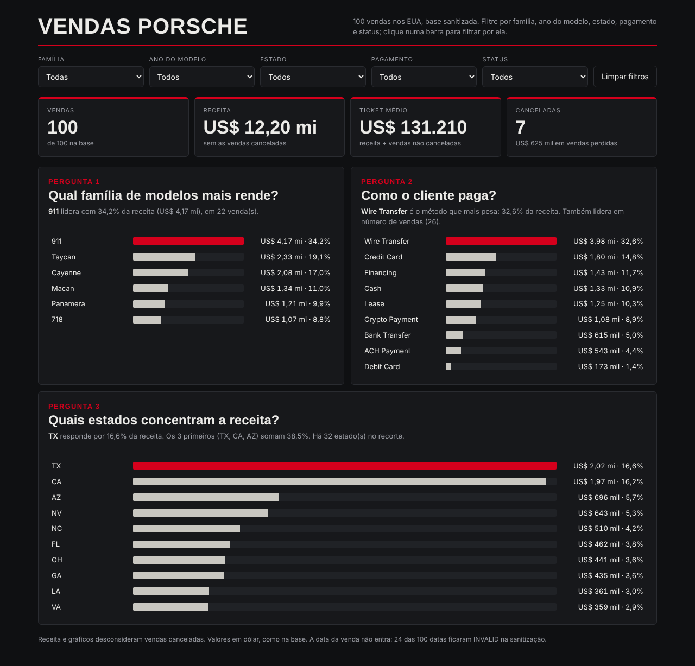
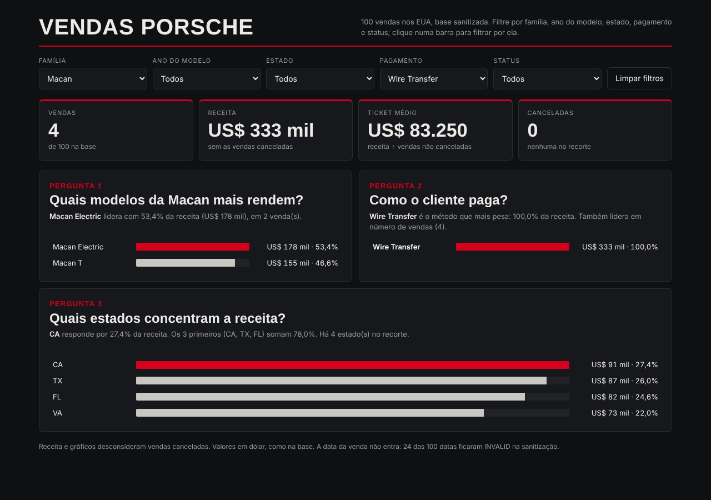

# Dashboard de vendas da Porsche

Dashboard em um único `index.html` (dados embutidos, sem biblioteca externa) feita a partir de 100 vendas de Porsche nos EUA. Responde três perguntas de negócio e deixa recortar por família, ano do modelo, estado, método de pagamento e status.

**Dashboard publicada:** https://data-vitor.github.io/notas-bootcamp/projetos/excel/dashboard-vendas-porsche/

Exemplo de filtro aplicado (família Macan + pagamento Wire Transfer, 4 vendas, US$ 333 mil):

## Perguntas de negócio e por que escolhi

1. **Qual família de modelos mais rende?** A base tem 40 modelos e a maioria aparece 2 ou 3 vezes, então um gráfico por modelo seria ruído. Agrupei por família (911, 718, Cayenne, Macan, Panamera, Taycan). Ao filtrar uma família, o gráfico passa a mostrar os modelos dela.
2. **Como o cliente paga?** O método de pagamento muda o risco e o ritmo do caixa (financiamento e leasing não são dinheiro na hora). A dashboard mostra o método que pesa mais na receita e diz se ele também lidera em número de vendas.
3. **Quais estados concentram a receita?** Mostra onde está o mercado. Troquei cidade por estado porque são 79 cidades para 100 vendas (quase todas com 1 venda).

Indicadores de topo: vendas, receita, ticket médio e canceladas.

## Tratamento da base

Usei só as colunas sanitizadas (`PorscheModelSanitized`, `ModelYearSanitized`, `SalesPriceSanitized`, `VehicleMileageSanitized`, `PayMethodSanitized`, `CitySanitized`, `StateSanitized`, `DeliveryStatusSanitized`), com preço, ano e milhas como número. Conferi: nenhuma célula vazia nessas colunas e `sale_id` único.

Decisões que tomei:
- **Nome do cliente e vendedor ficaram de fora.** A base vai embutida no HTML e não precisava de dado pessoal. Por isso a planilha original não está no repositório.
- **A data da venda não entra.** 24 das 100 datas ficaram `INVALID` na sanitização (datas impossíveis como 30/02) e 15 das válidas caem em 2027, algumas já como "Delivered". Usar essa coluna ia dar um gráfico de tendência que eu não consigo defender. O filtro de ano usa o **ano do modelo**, que está completo.
- **Status agrupado em 3:** `Entregue`, `Cancelada` e `Em andamento` (Pending, In Transit, Shipped e as variações de Awaiting). O original tem 10 valores.
- **Receita não conta venda cancelada** (7 vendas, US$ 625 mil). O número de vendas conta todas.

Resultado da base inteira: 100 vendas, receita de US$ 12.202.550,50, ticket médio de US$ 131.210 e 7 canceladas. A tabela tratada está em `dados/vendas-porsche-tratadas.csv`.

## Ferramenta e prompt

Usei **um agente (Claude)**, que escreveu o HTML direto. Não usei o ChatGPT com Canvas nem um agente com skill própria, então não comparei os dois caminhos que o curso mostra.

O pedido foi: montar uma dashboard em HTML de arquivo único a partir da planilha sanitizada, com três perguntas de negócio, filtros, indicadores de topo e visual coerente, publicável no GitHub Pages. As escolhas de perguntas, do que ficaria fora (nome, data) e da regra da receita foram decididas em cima da exploração da base descrita acima.

O que mudou até a versão final:
- A coluna de valores quebrava em duas linhas nos gráficos. Alarguei a coluna e travei a quebra.
- O texto da pergunta 2 repetia o método quando o líder em receita e em quantidade era o mesmo. Agora diz "também lidera em número de vendas".
- O texto da pergunta 3 falava dos "3 primeiros" mesmo com menos de 3 estados no recorte. Agora só aparece com 3 ou mais.

## Como conferi

Abri a página no Chromium e comparei os números com um cálculo em Python: base inteira (100 / US$ 12,20 mi / US$ 131.210 / 7 canceladas), Macan + Wire Transfer (4 / US$ 333 mil / US$ 83.250) e o estado líder (TX, US$ 2.023.400,50, 14 vendas). Clicar numa barra aplica o filtro. Os prints foram tirados sem as fontes do Google (Inter e Barlow Condensed), então a página online fica com a tipografia um pouco diferente.

## Limites

- Os dados são 100 linhas, então percentuais por família ou estado variam muito com poucas vendas.
- Sem gráfico de tendência no tempo (ver acima).
- A regra de datas `INVALID` e a revisão de datas futuras ficaram como próximo passo.

## Arquivos

- `index.html`: a dashboard.
- `dados/vendas-porsche-tratadas.csv`: base tratada usada na dashboard.
- `imagens/`: os dois prints.
