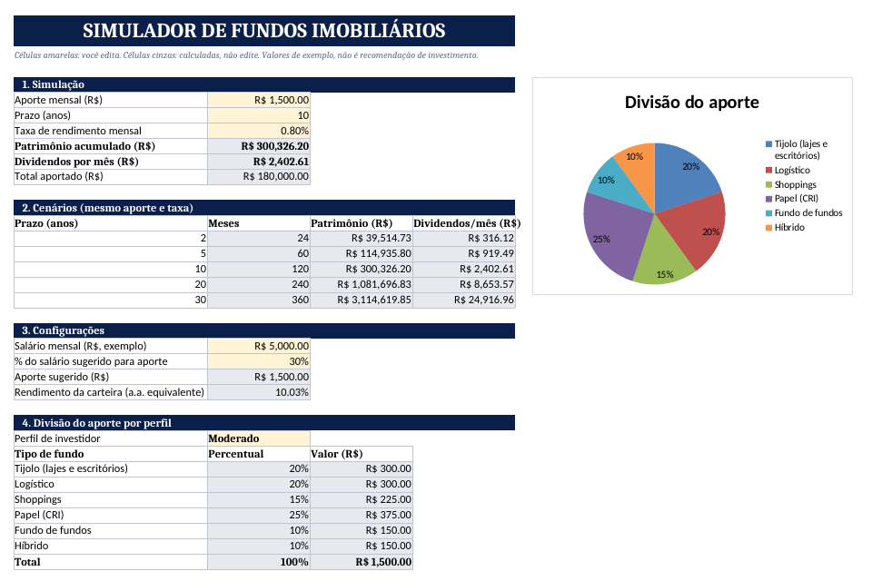
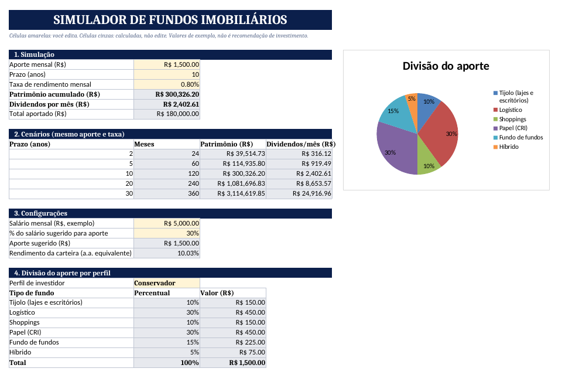

# Simulador de fundos imobiliários (Excel)

Projeto do desafio da DIO em que se monta no Excel uma ferramenta que simula aportes mensais em fundos imobiliários, do patrimônio aos dividendos, e divide o aporte por perfil de investidor. Parti de uma planilha em branco. Todos os valores (salário, aporte, taxa) são de exemplo.

## Resultado: mesma simulação, dois perfis

| Moderado | Conservador |
|---|---|
|  |  |

Aporte de R$ 1.500, 10 anos, 0,8% ao mês: a simulação não muda entre perfis, só a divisão do aporte e o gráfico de pizza.

## As cinco perguntas e onde estão as respostas (aba Simulador)

| Pergunta | Onde |
|---|---|
| Quanto investir por mês | `C7` (aporte), com sugestão de 30% do salário em `C25` |
| Por quantos anos | `C8` |
| Taxa de rendimento mensal | `C9` |
| Quanto de patrimônio vai acumular | `C10` |
| Quanto vai receber de dividendos por mês | `C11` |

Também há projeção para 2, 5, 10, 20 e 30 anos (`B16:E20`) e a divisão por perfil (`B31:D37`).

## Como VF e PROCV entram

- **VF** (função `FV` na base inglesa): `=VF(taxa_mensal; prazo_anos*12; -aporte)`. Taxa por mês, número de meses e o aporte com sinal negativo (é dinheiro que sai do bolso), para o patrimônio vir positivo. Os cenários repetem a conta com referências absolutas (`$C$9`, `$C$7`) e só o número de meses muda.
- **Dividendos** = patrimônio × taxa mensal. É uma simplificação: assume que o fundo paga a mesma taxa sobre o patrimônio.
- **PROCV com chave composta**: na aba Apoio, a coluna A junta perfil e tipo (`Moderado|Logístico`). Na divisão do aporte, `=PROCV(perfil&"|"&B31; tabela_perfis; 4; FALSO)` acha o percentual daquele tipo naquele perfil. Valor em reais = aporte × percentual.

## Intervalos nomeados

`aporte` (C7), `prazo_anos` (C8), `taxa_mensal` (C9), `salario` (C23), `pct_aporte` (C24), `perfil` (C29), `lista_perfis` (Apoio!F2:F4, alimenta a lista suspensa) e `tabela_perfis` (Apoio!A2:D19).

## Percentuais por perfil

São exemplos meus, sem fonte oficial, e não são recomendação de investimento. Cada perfil soma 100%.

| Tipo | Conservador | Moderado | Arrojado |
|---|---|---|---|
| Tijolo (lajes e escritórios) | 10% | 20% | 25% |
| Logístico | 30% | 20% | 10% |
| Shoppings | 10% | 15% | 15% |
| Papel (CRI) | 30% | 25% | 40% |
| Fundo de fundos | 15% | 10% | 5% |
| Híbrido | 5% | 10% | 5% |

## O que fiz de diferente do Expert

Não tenho a planilha do Expert para comparar, então não afirmo diferenças com ela. O que está aqui: gráfico de pizza que acompanha o perfil, rendimento anual equivalente da carteira (`C26`), total aportado (`C12`) e arquivo gerado por script (`gerar_planilha.py`, openpyxl).

## Validação

Conferi os resultados em Python com a fórmula fechada do valor futuro: 10 anos dá R$ 300.326,20 e R$ 2.402,61 de dividendos por mês; 2, 5, 20 e 30 anos dão R$ 39.514,73, R$ 114.935,80, R$ 1.081.696,83 e R$ 3.114.619,85. A planilha recalculada no LibreOffice tem os mesmos valores, sem erro de fórmula, e os três perfis somam 100%.

**Não testado:** abertura no Excel propriamente dito (usei o LibreOffice), a lista suspensa clicada à mão (só o perfil Moderado e o Conservador foram gerados e conferidos), banner em imagem, esconder barra de fórmulas e guias.
