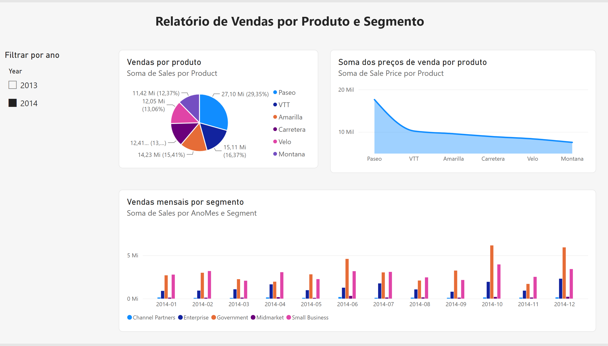
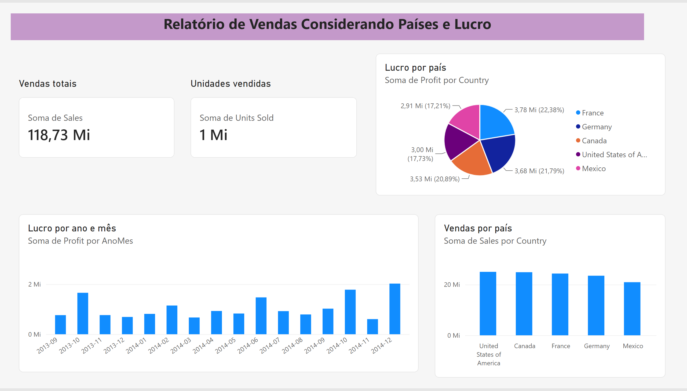
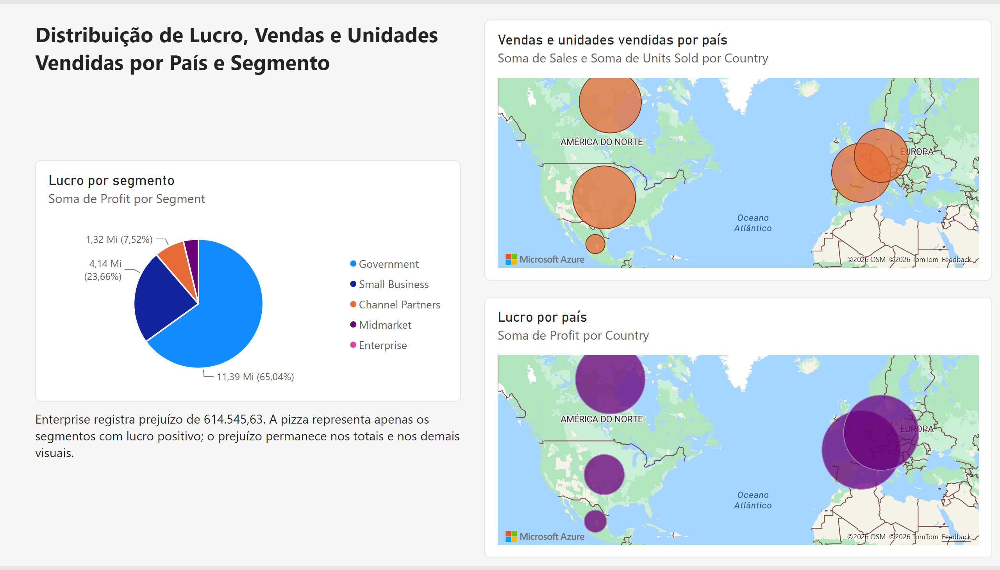

# Dashboard de vendas e lucro — Power BI

Projeto do bootcamp Santander/DIO, desenvolvido por Vitor Matias do Nascimento para o desafio **Analisando dados com SQL Analytics e Power BI**. O relatório usa o Financial Sample da Microsoft, replica as duas primeiras páginas do material do curso e inclui a terceira página com os visuais solicitados.

## Arquivos da entrega

| Arquivo | Conteúdo |
|---|---|
| [Relatório Power BI (.pbix)](relatorio/dashboard-vendas.pbix) | Relatório editável com três páginas e modelo de dados incluído. |
| [Apresentação PowerPoint (.pptx)](apresentacao/dashboard-vendas.pptx) | Exportação do Power BI: capa e três páginas do relatório, como imagens. |
| [Base Financial Sample (.xlsx)](dados/Financial%20Sample.xlsx) | Base utilizada para conferência e reprodução do projeto. |
| [Consulta Power Query (.pq)](power-query/financials.pq) | Importação, tipos de dados, limpeza dos nomes e coluna AnoMes. |
| [Conferência dos arquivos e valores (.json)](validacao/conferencia.json) | Totais da base e verificações da estrutura dos arquivos. |

Para baixar o PBIX ou o PowerPoint, abra o arquivo e use **Download raw file** no GitHub. O relatório completo pode ser avaliado pelos arquivos e pelas imagens abaixo.

## Páginas do relatório

### 1. Vendas por produto

Filtro de ano; vendas por produto em pizza; soma dos preços de venda por produto em área; vendas mensais por segmento em colunas. A seleção inicial é **2014**, seguindo a referência do curso. O gráfico de área agrega `Sale Price` por soma, como no material original; esse indicador não representa faturamento nem preço médio.

### 2. Países e lucro

Cartões com vendas totais e unidades vendidas, pizza de lucro por país, colunas de lucro por ano e mês e colunas de vendas por país. Os meses foram ordenados cronologicamente.

### 3. Distribuição geográfica

| Visual exigido | Campos configurados |
|---|---|
| Mapa de vendas e unidades vendidas por país | Localização: `Country`; tamanho: soma de `Sales`; dica de ferramenta: soma de `Units Sold`. |
| Mapa de lucro por país | Localização: `Country`; tamanho: soma de `Profit`. |
| Pizza de lucro por segmento | Legenda: `Segment`; valores: soma de `Profit`. |

Os mapas usam **Azure Maps**. Os visuais receberam títulos em português e a página inclui uma observação sobre o prejuízo do segmento Enterprise.

## Dados e tratamento

A base possui **700 registros e 16 colunas originais**, de setembro de 2013 a dezembro de 2014, com cinco países, seis produtos e cinco segmentos. Não foram encontrados valores nulos nas células da tabela.

O Power Query remove espaços dos nomes de coluna — incluindo o espaço inicial de ` Sales` —, define tipos textuais, numéricos, datas e valores monetários e adiciona `AnoMes` no formato `yyyy-MM`. As unidades vendidas mantêm as casas decimais presentes na fonte. O modelo usa a tabela `financials` e agregações por soma, conforme o escopo de criação de visuais deste desafio.

A importação no Power BI Service utiliza a [amostra pública oficial da Microsoft](https://go.microsoft.com/fwlink/?LinkID=521962), com acesso anônimo. Os totais foram conferidos com o Excel incluído nesta pasta.

### Totais sem filtro de ano

| Indicador | Valor |
|---|---:|
| Vendas líquidas — Sales | 118.726.350,26 |
| Unidades vendidas — Units Sold | 1.125.806 |
| Lucro — Profit | 16.893.702,26 |
| Vendas brutas — Gross Sales | 127.931.598,50 |
| Descontos — Discounts | 9.205.248,24 |
| Custo das vendas — COGS | 101.832.648,00 |

Foram verificadas as reconciliações `Sales = Gross Sales - Discounts` e `Profit = Sales - COGS`. Os valores financeiros são apresentados como números da amostra, sem atribuir uma moeda local. Nos cartões, `Mi` representa milhões; o cartão de unidades aparece arredondado para `1 Mi`.

**Limitação da pizza:** Enterprise registra lucro negativo de **-614.545,625** na base, exibido como prejuízo de **614.545,63** na observação da terceira página. A pizza representa apenas os segmentos com lucro positivo; seus percentuais usam a soma desses segmentos. O prejuízo continua compondo o lucro total, os países e os demais visuais aplicáveis.

## Publicação e como abrir

O relatório foi salvo no Power BI Service, na pasta `bootcamp-BI` do workspace do autor:

[Consultar o relatório no Power BI](https://app.powerbi.com/groups/674815c3-86e3-497c-a11d-369a936d20eb/reports/855b92ef-f296-446a-94aa-36bcad865592)

Esse link exige autenticação e permissão no workspace. A entrega pública neste repositório inclui o PBIX, o PowerPoint e as imagens das três páginas para avaliação.

1. Baixe `relatorio/dashboard-vendas.pbix` e abra em uma versão atual do **Power BI Desktop**.
2. Navegue pelas três páginas e use o filtro de ano na primeira página. Posicione o cursor sobre as bolhas do mapa de vendas para consultar as unidades vendidas.
3. Para atualizar a base, mantenha a fonte Web pública configurada no Power Query. Se preferir usar o Excel desta pasta, altere a origem para o arquivo local e mantenha a navegação para a tabela `financials`.
4. Para apresentar o resultado, abra `apresentacao/dashboard-vendas.pptx`. A apresentação contém imagens estáticas; a interação está no relatório Power BI.

## Verificação e referências

O PBIX exportado contém três páginas, modelo de dados e dois visuais Azure Maps. Foram conferidos os campos dos mapas, a dica de ferramenta de unidades vendidas, os limites de posição dos visuais e a integridade do arquivo. O PowerPoint possui quatro slides; suas páginas exportadas foram revisadas visualmente e seus arquivos XML foram lidos sem erro.

- [Repositório de referência do curso — Juliana Zanelatto](https://github.com/julianazanelatto/power_bi_analyst).
- [Relatório original utilizado como referência das páginas](https://github.com/julianazanelatto/power_bi_analyst/blob/main/M%C3%B3dulo%201/Primeiros%20passos%20com%20Power%20BI/sample_financial.pbix).
- [Financial Sample — Microsoft](https://go.microsoft.com/fwlink/?LinkID=521962).

Os dados são uma amostra didática. A referência do curso e a fonte da base estão identificadas acima.

