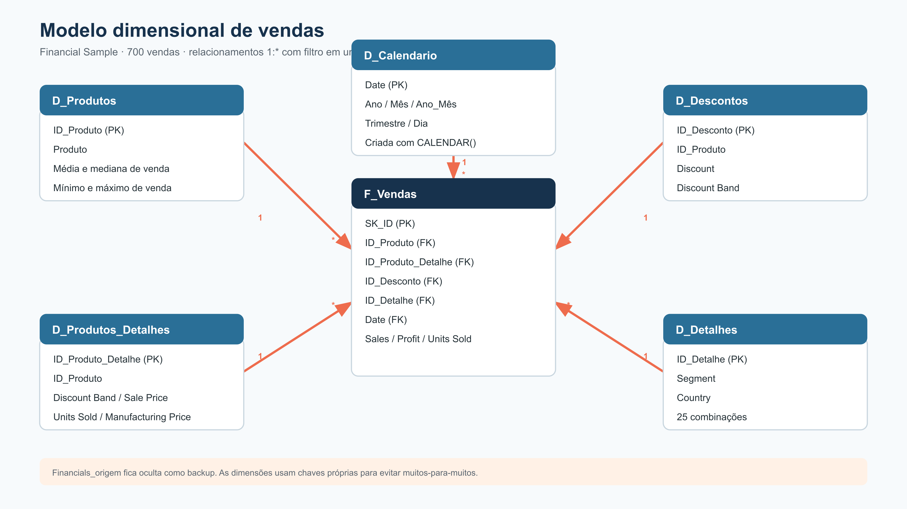

# Modelagem e transformação de dados com DAX

Projeto desenvolvido para o desafio da DIO usando a amostra **Financials** da Microsoft. A ideia foi sair da tabela única e montar um modelo dimensional simples, com uma tabela fato no centro e dimensões para produto, descontos, detalhes de mercado e calendário.



## Modelo criado

- **F_Vendas**: concentra as métricas e chaves das 700 vendas.
- **D_Produtos**: cadastro dos seis produtos e estatísticas de venda.
- **D_Produtos_Detalhes**: preço, faixa de desconto, custo de fabricação e unidades.
- **D_Descontos**: descontos por produto e faixa.
- **D_Detalhes**: combinações de segmento e país.
- **D_Calendario**: calendário contínuo criado com DAX.
- **Financials_origem**: cópia da tabela bruta, mantida oculta para conferência.

As dimensões filtram a tabela fato em relacionamentos `1:*`, com direção única. Nas tabelas mais detalhadas, incluí chaves próprias (`ID_Produto_Detalhe`, `ID_Desconto` e `ID_Detalhe`) para evitar relacionamentos muitos-para-muitos.

## Transformações realizadas

1. Importação e conferência da planilha oficial.
2. Separação da origem em fato e dimensões.
3. Conversão dos campos numéricos usados em cálculos.
4. Criação de chaves para cada nível de granularidade.
5. Criação da tabela calendário com `CALENDAR()`.
6. Configuração dos cinco relacionamentos ativos.
7. Ocultação da tabela de origem no modelo final.

Exemplo da tabela calendário:

```DAX
D_Calendario =
VAR DataInicial = MIN ( F_Vendas[Date] )
VAR DataFinal = MAX ( F_Vendas[Date] )
RETURN
    ADDCOLUMNS (
        CALENDAR ( DataInicial, DataFinal ),
        "Ano", YEAR ( [Date] ),
        "Mes_Numero", MONTH ( [Date] ),
        "Mes", FORMAT ( [Date], "mmmm" ),
        "Ano_Mes", FORMAT ( [Date], "yyyy-MM" ),
        "Trimestre", "T" & FORMAT ( [Date], "Q" )
    )
```

As expressões usadas para montar as tabelas estão em [`dax/tabelas_calculadas.dax`](dax/tabelas_calculadas.dax), e as medidas sugeridas estão em [`dax/medidas.dax`](dax/medidas.dax). As consultas M usadas para documentar a transformação estão na pasta [`power-query`](power-query).

## Conferência dos dados

- 700 linhas na origem e na tabela fato.
- 6 produtos.
- Período de 01/09/2013 a 01/12/2014.
- Vendas totais: **118.726.350,26**.
- Lucro total: **16.893.702,26**.
- Nenhuma chave órfã nos cinco relacionamentos.

O arquivo [`modelo/modelo-financials-star-schema.xlsx`](modelo/modelo-financials-star-schema.xlsx) permite conferir todas as tabelas sem precisar abrir o Power BI.

## Arquivos principais

```text
dados/          planilha Financial Sample original
dax/            tabela calendário e medidas
imagens/        desenho do modelo dimensional
modelo/         workbook de conferência e relacionamentos
power-query/    consultas M documentadas
relatorio/      arquivo PBIX exportado do Power BI
```

## Fonte

Dados: [Financial Sample da Microsoft](https://learn.microsoft.com/pt-br/power-bi/create-reports/sample-financial-download).

Modelo publicado no Power BI Service: [abrir modelo semântico](https://app.powerbi.com/groups/674815c3-86e3-497c-a11d-369a936d20eb/datasets/bec0569b-2a75-436d-ac45-9586d28ba05a?experience=power-bi).
