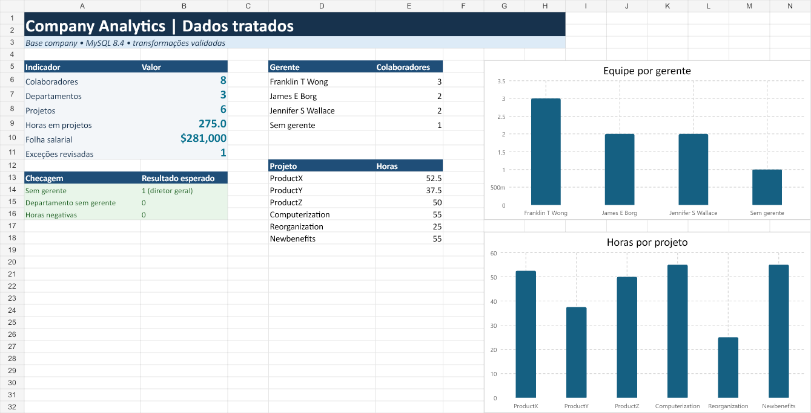

# Processando e Transformando Dados com Power BI

Projeto do bootcamp Santander/DIO usando o banco `company`, MySQL e Power BI. O foco foi corrigir a carga original, tratar a base e publicar uma visão simples de pessoas, departamentos e gestão.



## Entrega

- [Relatório publicado no Power BI Service](https://app.powerbi.com/groups/674815c3-86e3-497c-a11d-369a936d20eb/reports/fd470959-f8c7-435b-84f3-27898561299d/78519e046d1ac021b772?experience=power-bi)
- [Arquivo do Power BI Desktop](DIO%20-%20Company%20Analytics%20-%20Vitor.pbix)
- [Planilha com dados brutos, tratados e checagens](company_tratado.xlsx)
- [Scripts SQL corrigidos](sql/)
- [Consultas Power Query (M)](power-query/)
- [Arquivos CSV usados para conferência](data/)

O relatório publicado contém um cartão com a folha salarial total e comparações de salário por departamento e por gerente.

## O que foi feito

1. O modelo `company` foi criado e carregado em MySQL 8.4.
2. Os scripts originais foram ajustados para usar o mesmo banco e respeitar a hierarquia da chave estrangeira `Super_ssn`.
3. Os tipos foram revisados: datas como data, identificadores como texto, números de departamento como inteiro e salário como valor monetário.
4. O endereço foi separado em número, rua, cidade e estado. A divisão foi feita a partir da direita para preservar nomes de rua com hífen, como `Fire-Oak`.
5. Nome e sobrenome foram combinados em `Employee_name`.
6. A tabela de funcionários foi mesclada com departamento e com ela mesma para obter o gerente de cada pessoa.
7. Departamento e localização foram mesclados em uma tabela própria.
8. Os colaboradores foram agrupados por gerente.

## Decisões de qualidade

- O único `Super_ssn` nulo pertence a James Borg, gerente geral; portanto, o valor foi mantido e exibido como **Sem gerente**.
- Não existem departamentos sem gerente.
- Não existem horas negativas em `works_on`.
- O tratamento resultou em 8 colaboradores, 3 departamentos, 6 projetos e 275 horas registradas.

### Por que mesclar e não acrescentar?

**Mesclar** relaciona colunas de tabelas diferentes usando uma chave. Foi o procedimento correto para ligar `Dno` a `Dnumber` e `Super_ssn` a `Ssn`, mantendo uma linha por funcionário. **Acrescentar** empilharia registros e exige tabelas com a mesma estrutura; nesse caso, misturaria entidades diferentes e não criaria as relações pedidas.

## Correções aplicadas aos arquivos de origem

O material original alternava entre os bancos `azure_company` e `company_constraints`, removia uma tabela sem verificar sua existência e carregava funcionários antes de seus supervisores. Os scripts desta entrega corrigem esses pontos:

- [`01_schema_corrigido.sql`](sql/01_schema_corrigido.sql): estrutura e restrições;
- [`02_carga_corrigida.sql`](sql/02_carga_corrigida.sql): carga em ordem válida;
- [`03_consultas_transformacao.sql`](sql/03_consultas_transformacao.sql): consultas usadas para validar as transformações.

## Estrutura

```text
processamento-dados-company/
├── data/                 # extrações brutas e tabelas tratadas
├── images/               # evidência visual das validações
├── power-query/          # consultas M reproduzíveis
├── sql/                  # criação, carga e consultas
├── DIO - Company Analytics - Vitor.pbix
├── company_tratado.xlsx  # workbook de auditoria
└── README.md
```

## Observação sobre Azure

O fluxo foi validado em uma instância MySQL 8.4 local para evitar provisionar um recurso pago sem confirmação. As consultas M mantêm o conector `MySQL.Database` preparado para receber o endereço de uma instância Azure Database for MySQL. O relatório final foi publicado no Power BI Service.

## Referência

- [Repositório da instrutora](https://github.com/julianazanelatto/power_bi_analyst)
- [Documentação do conector MySQL no Power Query](https://learn.microsoft.com/power-query/connectors/mysql-database)
