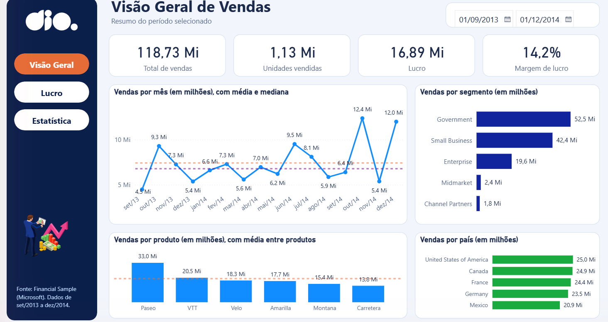
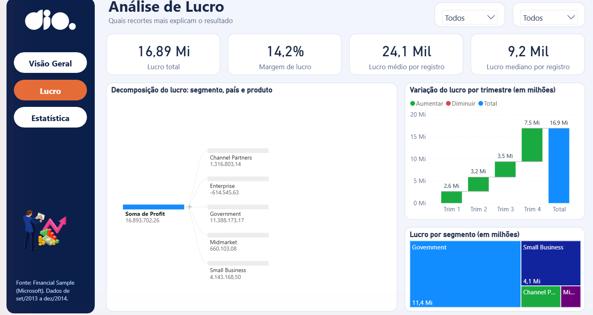
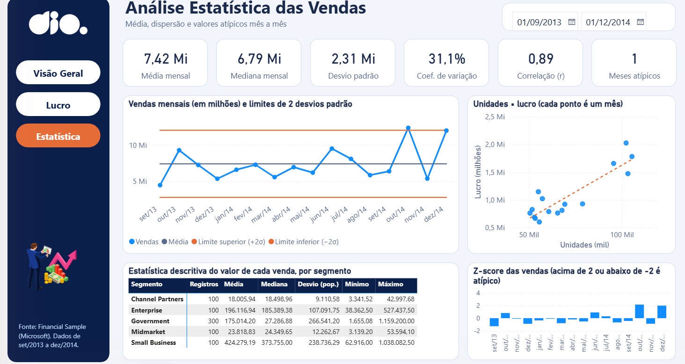

# Relatório estatístico com foco em experiência do usuário (Power BI)

Segundo projeto do desafio **Atualizando Relatório Financeiro com Foco na Experiência do Usuário**, da DIO. Dessa vez parti do relatório criativo da instrutora e, além de refazer o layout (posicionamento, contraste, proporção áurea, segmentação e navegação), troquei os visuais por análises com viés estatístico: média, mediana, desvio padrão, coeficiente de variação, limites de 2 desvios, Z-score, correlação e linha de tendência. A base é a Financial Sample da Microsoft (700 linhas, set/2013 a dez/2014).

## Resultado

| Visão Geral | Lucro | Estatística |
|---|---|---|
|  |  |  |

## O que o desafio pedia e o que fiz

| Pedido | Como ficou |
|---|---|
| Posicionamento | Menu fixo à esquerda, título e filtro de período no topo, indicadores logo abaixo, gráficos embaixo. O resumo vem antes do detalhe. |
| Contraste | Menu azul-marinho com texto branco, cartões brancos sobre fundo claro, laranja só para o que precisa de destaque (página atual, linha de tendência e limites). |
| Proporção áurea | Colunas de 620 e 384 px (razão de 1,61) e linhas de 292 e 180 px (1,62). |
| Segmentação dos dados | Segmentador de período (Visão Geral e Estatística) e duas listas suspensas na página Lucro. |
| Botões de navegação | Menu com Visão Geral, Lucro e Estatística repetido nas três páginas. |
| Focalizar e selecionar | Cada botão tem estados padrão (branco), ao focalizar, ao pressionar e selecionado (laranja). O botão da página atual já vem fixo em laranja para a pessoa saber onde está. |
| Segunda página parecida com a primeira | Lucro usa o mesmo fundo, menu, cabeçalho e linha de indicadores da Visão Geral. |
| Visuais com viés estatístico | Ver a próxima seção. |

## Páginas e o que cada visual diz

**Visão Geral.** Indicadores de vendas, unidades, lucro e margem. Vendas por mês com duas linhas de referência (média e mediana), vendas por produto com a média entre produtos, vendas por segmento e por país.

**Lucro.** Lucro total, margem, lucro médio e lucro mediano por registro. A média (24,1 mil) fica bem acima da mediana (9,2 mil), o que indica distribuição assimétrica, puxada por poucas vendas grandes. A árvore de decomposição abre o lucro por segmento, país e produto, a cascata mostra a contribuição de cada trimestre e o treemap compara segmentos. Enterprise tem lucro negativo (-0,61 Mi), então não aparece no treemap, que não desenha valores negativos; ela aparece na árvore.

**Estatística.**
- Média mensal 7,42 Mi, mediana 6,79 Mi, desvio padrão 2,31 Mi e coeficiente de variação de 31,1%: a venda mensal oscila bastante em torno da média.
- Gráfico de controle: vendas por mês com a média e os limites de média ± 2 desvios. Só outubro/2014 (12,4 Mi) fica acima do limite superior.
- Z-score por mês: mesmo critério em outra escala (acima de 2 ou abaixo de -2 é atípico). O cartão "Meses atípicos" conta esses meses (1).
- Dispersão de unidades por lucro, um ponto por mês, com linha de tendência linear. Correlação de 0,89: meses com mais unidades vendidas tendem a ter mais lucro.
- Matriz de estatística descritiva do valor de cada venda por segmento (registros, média, mediana, desvio, mínimo e máximo). Government tem média de 175 mil e mediana de 27 mil, outra evidência de distribuição assimétrica.

As fórmulas estão em [`medidas.dax`](medidas.dax).

## Decisões

- Troquei os visuais personalizados da instrutora (radar e chiclet) por visuais nativos. Assim o arquivo abre em qualquer Power BI Desktop sem instalar nada.
- Média, mediana e desvio padrão são calculados sobre o total de cada mês (16 observações), não sobre as 700 linhas. Cada pergunta usa a granularidade que faz sentido: mensal para a tendência, por registro para a distribuição.
- Os limites do gráfico de controle são média ± 2 desvios (desvio amostral, STDEVX.S). Com 16 meses, isso marca como atípico o que fica fora de mais ou menos 95% da variação esperada se os dados fossem normais; não testei normalidade.
- A correlação é entre unidades e lucro mensais (16 pontos), não entre as linhas da base. Correlação não é causa, só diz que as duas séries andam juntas.
- A linha de tendência só existe nativamente no gráfico de dispersão. No gráfico de linhas, o Power BI não oferece tendência quando há várias séries, então usei as linhas de média e limites.
- A coluna de desvio da matriz é populacional (a agregação nativa da matriz é essa); os cartões e o gráfico de controle usam o amostral. Por isso o desvio por segmento na matriz é um pouco menor do que o do pandas com `ddof=1` (por exemplo, 9.110 contra 9.156 em Channel Partners). Está rotulada como "(pop.)".
- Valores em milhões ou mil, sempre dito no título do visual.

## Arquivos

| Arquivo | Uso |
|---|---|
| `relatorio/DIO - Relatorio Estatistico UX - Vitor.pbix` | Relatório para abrir no Power BI Desktop. |
| `medidas.dax` | As 11 medidas DAX do modelo. |
| `dados/Financial Sample.xlsx` | Base usada. |
| `assets/` | Logo e ilustração do menu (vêm do material da instrutora). |
| `imagens/` | Prints das três páginas. |
| `VALIDACAO.md` | Conferências feitas e o que ficou sem testar. |

## Como abrir

1. Baixe o `.pbix`.
2. Abra no Power BI Desktop (versão recente, o arquivo usa o formato de relatório PBIR).
3. Os dados já estão dentro do arquivo. Para testar os botões, use o modo de leitura ou Ctrl + clique.

## Limitações

- Não publiquei no Power BI Service, só o arquivo está aqui.
- Os efeitos de focalizar e pressionar só aparecem no modo de leitura; no modo de edição conferi a aparência das páginas, não o comportamento.
- Ao abrir o arquivo, o Desktop mostra a faixa "contém um visual personalizado que precisa ser salvo". O relatório só usa visuais nativos e retirei do arquivo o registro dos visuais personalizados da instrutora, mas a faixa continuou aparecendo; não descobri a causa. É só um aviso, pode fechar no OK.
- Sem layout de celular.

## Referências

- [Financial Sample da Microsoft](https://learn.microsoft.com/power-bi/create-reports/sample-financial-download)
- [Repositório do curso: julianazanelatto/power_bi_analyst](https://github.com/julianazanelatto/power_bi_analyst)
