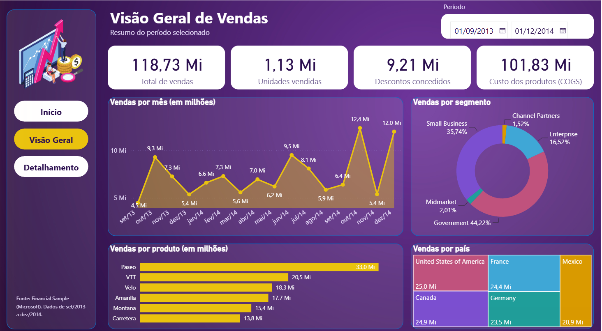
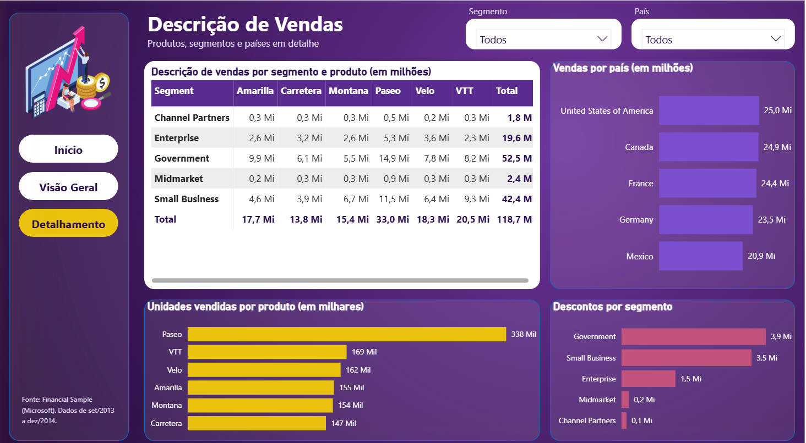

# Relatório financeiro com foco em experiência do usuário — Power BI

Projeto do desafio **Atualizando Relatório Financeiro com Foco na Experiência do Usuário**, da DIO. Peguei o Sales Report criativo da instrutora (capa mais uma página) e refiz o layout pensando em quem vai ler: onde cada coisa fica, contraste, proporção e como a pessoa se move entre as páginas. A base é a Financial Sample da Microsoft, a mesma do projeto anterior.

## Resultado

| Home | Visão Geral | Detalhamento |
|---|---|---|
|  |  |  |

## O que o desafio pedia e o que fiz

| Pedido | Como ficou |
|---|---|
| Posicionamento | Menu sempre à esquerda, título e filtros no topo, indicadores logo abaixo do título, gráficos embaixo. O olho lê de cima para baixo e da esquerda para a direita, então o resumo vem antes do detalhe. |
| Contraste | Fundo roxo escuro com cartões brancos para os números principais e texto claro sobre os painéis escuros. Dourado só para o que precisa de destaque (série principal e página atual). |
| Proporção áurea | Colunas de 620 e 384 px (razão de 1,61). Na Visão Geral as linhas dos gráficos têm 292 e 180 px; no Detalhamento, 358 e 222 px. |
| Segmentação dos dados | Visão Geral com segmentador de período. Detalhamento com listas suspensas de segmento e país, que filtram a matriz e os gráficos da página. |
| Botões de navegação | Menu com **Início**, **Visão Geral** e **Detalhamento** repetido em cada página, mais o botão **Explorar análise** na capa. |
| Focalizar e selecionar | Cada botão tem quatro estados de cor: padrão (branco), ao focalizar (rosa), ao pressionar (rosa escuro) e selecionado (dourado). Além disso, o botão da página atual já vem fixo em dourado, para a pessoa saber onde está sem depender do estado. |
| Segunda página parecida com a primeira | A Visão Geral usa o mesmo fundo, menu e cartões da capa; o Detalhamento segue o mesmo padrão. |

## Páginas

**Home.** Capa com o botão Explorar análise, que leva para a Visão Geral.

**Visão Geral.** Segmentador de período, quatro indicadores (vendas, unidades, descontos e COGS), vendas por mês, vendas por produto, vendas por segmento e vendas por país.

**Detalhamento.** Matriz de vendas por segmento e produto (em milhões), vendas por país, unidades por produto e descontos por segmento, com os segmentadores de segmento e país.

## Decisões

- Não criei medidas DAX. Todos os visuais usam soma implícita das colunas da base, então não há arquivo `.dax`.
- A matriz tem segmento nas linhas e produto nas colunas. Na primeira versão estava invertida e estourava a largura; os nomes dos produtos são curtos, os de segmento não.
- Datas no eixo como `set/13`, `out/13`, para caber sem cortar.
- Unidades em milhares e valores financeiros em milhões, sempre dito no título do visual.

## Arquivos

| Arquivo | Uso |
|---|---|
| `relatorio/DIO - Relatorio UX Financeiro - Vitor.pbix` | Relatório para abrir no Power BI Desktop. |
| `dados/Financial Sample.xlsx` | Base usada (700 linhas, set/2013 a dez/2014). |
| `assets/` | Imagens usadas no relatório: fundo, capa e ilustração do menu. |
| `imagens/` | Prints das três páginas. |
| `VALIDACAO.md` | Conferências feitas e o que ficou sem testar. |

## Como abrir

1. Baixe o `.pbix`.
2. Abra no Power BI Desktop.
3. Se pedir para atualizar a fonte, os dados já estão dentro do arquivo.
4. Para testar os botões, use o modo de leitura ou Ctrl + clique no modo de edição.

## Limitações

- O relatório não foi publicado no Power BI Service, só o arquivo está aqui.
- Os efeitos de focalizar e pressionar dependem do modo de leitura; no Desktop em modo de edição só conferi a aparência das páginas.
- A capa e a ilustração de fundo vêm do material da instrutora.

## Referências

- [Financial Sample da Microsoft](https://learn.microsoft.com/power-bi/create-reports/sample-financial-download)
- [Repositório do curso — julianazanelatto/power_bi_analyst](https://github.com/julianazanelatto/power_bi_analyst)
