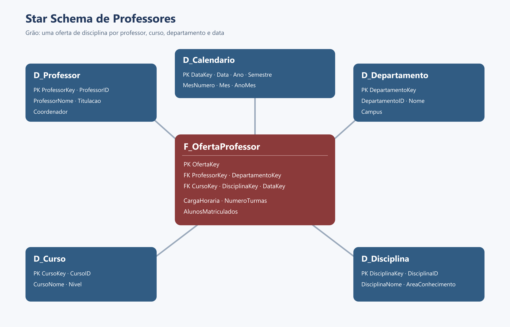

# Star Schema de Professores no Power BI

Projeto desenvolvido para o desafio **Criando um Star Schema para Cenários de Vendas com Power BI**, da DIO. O diagrama relacional de universidade foi transformado em um modelo dimensional voltado à análise da atuação dos professores.

> Os registros usados no relatório são fictícios. O enunciado fornece o diagrama, mas não uma base preenchida, e permite assumir campos de data para construir a dimensão calendário.

## Resultado



O modelo publicado no Power BI Service possui cinco relacionamentos ativos, todos com cardinalidade **muitos para um** e filtro cruzado em direção única:

- `F_OfertaProfessor[ProfessorKey]` → `D_Professor[ProfessorKey]`
- `F_OfertaProfessor[DepartamentoKey]` → `D_Departamento[DepartamentoKey]`
- `F_OfertaProfessor[CursoKey]` → `D_Curso[CursoKey]`
- `F_OfertaProfessor[DisciplinaKey]` → `D_Disciplina[DisciplinaKey]`
- `F_OfertaProfessor[DataKey]` → `D_Calendario[DataKey]`

**Granularidade da fato:** uma linha representa a oferta de uma disciplina por um professor, em um curso e departamento, na data inicial de um período letivo.

## Tabelas

| Tabela | Papel no modelo |
|---|---|
| `F_OfertaProfessor` | Fato central com carga horária, quantidade de turmas e alunos matriculados. |
| `D_Professor` | Identificação, nome, titulação e indicação de coordenação. |
| `D_Departamento` | Departamento e campus. |
| `D_Curso` | Curso e nível acadêmico. |
| `D_Disciplina` | Disciplina e área de conhecimento. |
| `D_Calendario` | Data, ano, semestre, mês e ano-mês. |

Os dados individuais de alunos ficaram fora do modelo, como solicitado. A tabela fato guarda apenas a contagem agregada de matriculados por oferta.

## Relatório

A página publicada apresenta:

- carga horária total;
- total de alunos matriculados;
- carga horária por professor.

Arquivo principal: [`DIO - Star Schema de Professores - Vitor.pbix`](DIO%20-%20Star%20Schema%20de%20Professores%20-%20Vitor.pbix)

Relatório publicado: [abrir no Power BI Service](https://app.powerbi.com/groups/674815c3-86e3-497c-a11d-369a936d20eb/reports/bf62cff6-244e-474a-8c79-295b9badc917/e3d68f665ad1970f6c6a?experience=power-bi)

Planilha de apoio: [`star_schema_professores.xlsx`](star_schema_professores.xlsx)

## Estrutura do repositório

```text
star-schema-professores/
├── data/       # tabelas em CSV
├── dax/        # medidas sugeridas para evolução do relatório
├── images/     # diagrama do modelo
├── modelo/     # dicionário resumido e decisões de modelagem
├── sql/        # criação das tabelas e chaves estrangeiras
├── DIO - Star Schema de Professores - Vitor.pbix
└── star_schema_professores.xlsx
```

## Decisões de modelagem

- Usei chaves artificiais (`ProfessorKey`, `CursoKey` etc.) nas dimensões e mantive os IDs de origem para rastreabilidade.
- Centralizei medidas aditivas na fato e atributos descritivos nas dimensões.
- Criei `D_Calendario` com datas de início de períodos letivos, pois a origem não fornece datas.
- Mantive o sentido de filtro das dimensões para a fato, evitando ambiguidade no modelo.

## Referência do desafio

- [Descrição oficial disponibilizada pela DIO](https://hermes.dio.me/files/assets/1a8288a4-51e9-4973-acbf-647d1adb782f.docx)

## Próximos passos possíveis

- adicionar indicadores de carga média por professor;
- criar uma página de análise por departamento e semestre;
- aplicar atualização incremental quando houver uma fonte histórica real.
